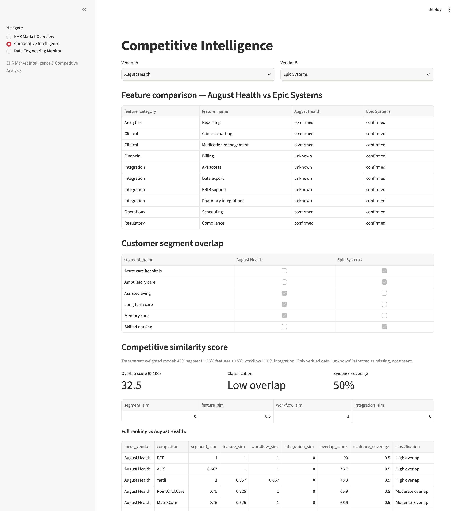
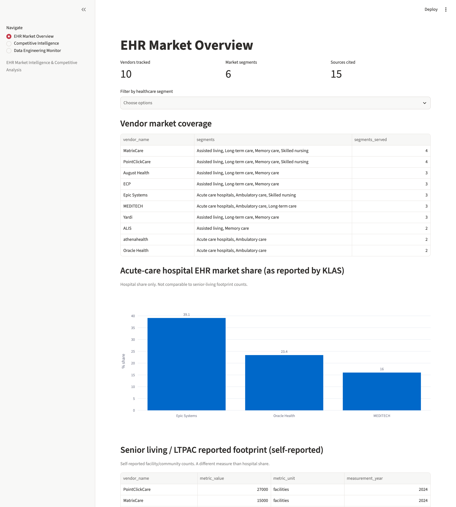
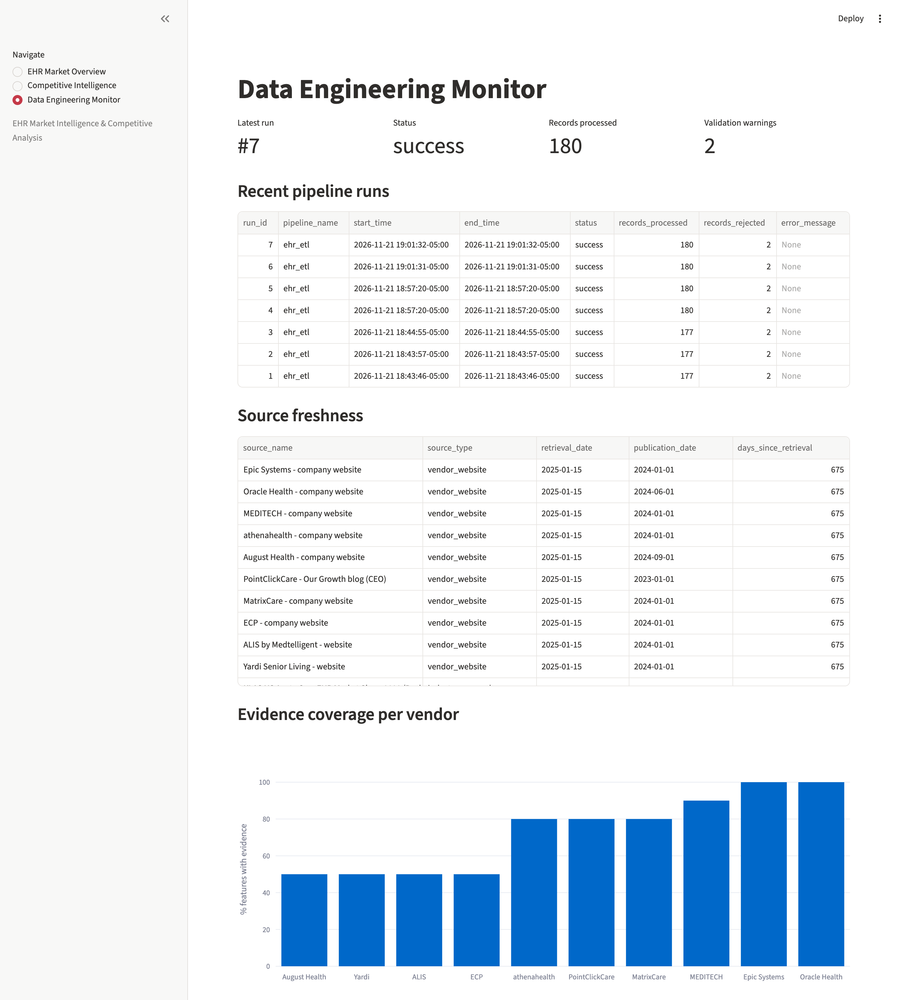

# EHR Market Intelligence & Competitive Analysis Platform

An end-to-end data engineering and analytics platform that collects, cleans,
validates, stores, and analyzes **publicly reported** information about Electronic
Health Record (EHR) vendors across healthcare markets — including an illustrative
similarity analysis of **August Health** relative to other senior-living software.

The data engineering (ETL pipeline, PostgreSQL schema, validation, data-quality
monitoring) is the foundation; the EHR analysis is the application.

> **Disclaimer / independent project.** This is an independent, educational
> portfolio project. It is **not affiliated with, authorized, endorsed by, or
> sponsored by** Epic, Oracle Health, MEDITECH, athenahealth, August Health,
> PointClickCare, MatrixCare, ECP, ALIS, Yardi, KLAS Research, or any other
> organization named here. All company and product names are the trademarks of
> their respective owners and are used for identification and commentary only.
> Figures are presented **as reported by the cited public sources** and may be
> incomplete, approximate, or out of date; they are not independently audited.
> The "similarity" and "overlap" scores are the output of a simple, transparent
> formula defined by this project — they are the author's analytical opinion for
> demonstration purposes, **not statements of fact** about any company's market
> position or competitive standing. See [Disclaimer](#disclaimer) for the full text.
> Nothing here is legal, financial, or professional advice. Figures should be
> re-verified against the original sources before any external use.)

## Key findings

1. **The hospital EHR market is highly concentrated.** Epic (39.1%), Oracle Health
   (23.4%), and MEDITECH (16.0%) together hold ~78.5% of U.S. acute-care hospitals
   (KLAS, 2023). Epic alone covers **51.5% of acute-care hospital beds** — more
   than its next two competitors combined.

2. **Under this project's similarity model, August Health scores most similar to
   other senior-living software.** On the limited public data collected here, the
   model's highest similarity scores for August Health are with senior-living
   vendors (e.g. ECP, ALIS, Yardi), and lower scores with enterprise-hospital
   vendors (e.g. Epic, Oracle Health). These are illustrative model outputs on
   partial data (evidence coverage ~50%), not a definitive competitive ranking.

3. **The model treats hospital and senior-living software as largely separate
   categories.** In the collected data, enterprise-hospital vendors and
   senior-living vendors serve mostly different customer segments
   (acute/ambulatory vs. assisted living / memory care), which is the main reason
   their similarity scores to August Health are low. This reflects the segments
   recorded in the dataset, not a judgment about any company's products.

4. **Hospital share and senior-living footprint are not comparable** — and the
   platform keeps them apart by design. PointClickCare reports **27,000+ LTPAC
   facilities** (self-reported); that is a *count*, not a percentage market share,
   and cannot be placed on the same axis as Epic's 39.1% hospital share.

5. **Data integrity is visible, not hidden.** Where a figure could not be verified
   (e.g. a specific MatrixCare facility count), the value is stored as **unknown /
   NULL rather than invented**, and ~27% of vendor–feature statuses are `unknown`
   (no public evidence found) rather than falsely marked absent.

---

## Dashboard preview

**Competitive Intelligence** — side-by-side feature comparison, segment overlap, and the transparent similarity score:



**EHR Market Overview** — vendor coverage, hospital market share, and senior-living footprint (kept separate by design):



**Data Engineering Monitor** — pipeline runs, source freshness, evidence coverage, and traceability gaps:



---

## What this demonstrates

- **Python ETL** — modular collect → clean → validate → load pipeline with logging and run tracking
- **PostgreSQL** — normalized schema, primary/foreign keys, constraints, indexes, idempotent **upserts**
- **Data cleaning & validation** — pandas standardization + rule-based blocking/non-blocking checks
- **SQL analytics** — market concentration, feature coverage, competitor overlap, data-quality monitoring
- **Transparent modeling** — a weighted, evidence-based competitor overlap score (no black-box ML)
- **Dashboard** — a 3-page Streamlit + Plotly app
- **Testing & CI** — pytest data-quality suite + GitHub Actions
- **Honest data practices** — every fact is source-tagged; unknowns are kept as *unknown*, never invented

---

## Architecture

```
seed CSVs ──► collect_data ──► data/raw/*.json ──► clean_data ──► data/processed/*.csv
                (snapshot)        (immutable)       (pandas)         (typed, deduped)
                                                                           │
                                                                           ▼
   Streamlit dashboard ◄── PostgreSQL ◄── load_database ◄── validate_data
      (3 pages)            (8 tables)        (upsert)      (blocking + warnings)
                                                 ▲
                                          run_pipeline (orchestrator + pipeline_runs tracking)
```

---

## Database schema (8 tables)

| Table | Purpose |
|---|---|
| `vendors` | Company profile (name, website, HQ, founded year, description) |
| `market_segments` | Healthcare segments (acute care, ambulatory, assisted living, memory care, skilled nursing, long-term care) |
| `product_features` | Standardized capabilities (charting, billing, meds, scheduling, reporting, compliance, pharmacy, API, export, FHIR) |
| `vendor_segments` | M:N vendor ↔ segment with `market_role` (primary/secondary) + source |
| `vendor_features` | M:N vendor ↔ feature with `availability_status` (confirmed/absent/unknown) + source + verified date |
| `market_metrics` | Market share / footprint observations, unit- and year-tagged, with a uniqueness guard |
| `sources` | Source references (URL, publication date, retrieval date, type) |
| `pipeline_runs` | Execution log (status, counts, errors) for monitoring |

Full DDL with constraints and indexes: [`sql/create_tables.sql`](sql/create_tables.sql).

---

## Setup

Requires Python 3.11+ and PostgreSQL 13+.

```bash
# 1. create the database
createdb ehr_market

# 2. python environment
python3 -m venv .venv
source .venv/bin/activate
pip install -r requirements.txt

# 3. configure connection
cp .env.example .env        # edit PGUSER / PGPASSWORD etc. as needed
```

## Run the pipeline

```bash
python src/run_pipeline.py        # collect → clean → validate → load (idempotent)
python src/analyze_competitors.py # competitor overlap scoring (prints ranking)
pytest -q                         # data-quality tests
streamlit run dashboard/app.py    # open the dashboard
```

Re-running `run_pipeline.py` is safe — upserts and the uniqueness constraints
guarantee no duplicated rows.

---

## dbt analytics layer (optional)

On top of the Python ETL, a small **dbt** project builds clean staging views and
analytics marts directly in PostgreSQL. This demonstrates a modern stack:
**ETL in Python, in-warehouse transformations in dbt.**

```
dbt/
├── dbt_project.yml · profiles.yml
├── models/staging/   # stg_vendors, stg_vendor_segments, stg_vendor_features, stg_market_metrics (views)
├── models/marts/     # vendor_market_coverage, competitor_overlap (tables)
└── tests/            # singular test: overlap_score in 0..100
```

- **Staging models** — typed, trimmed, normalized views over the raw tables.
- **Mart `vendor_market_coverage`** — segments served per vendor.
- **Mart `competitor_overlap`** — the weighted similarity model re-implemented in
  pure SQL; its output matches `src/analyze_competitors.py` exactly (two
  independent implementations agreeing = a correctness check).
- **Tests** — `not_null`, `unique`, `relationships`, `accepted_values`, plus a
  custom range test (22 tests total).

dbt does not yet build on Python 3.14, so run it in its own 3.9–3.12 venv:

```bash
python3.12 -m venv .dbt-venv
./.dbt-venv/bin/pip install -r requirements-dbt.txt
set -a; source .env; set +a                                   # export PG* vars
./.dbt-venv/bin/dbt run  --profiles-dir dbt --project-dir dbt  # build models
./.dbt-venv/bin/dbt test --profiles-dir dbt --project-dir dbt  # run tests
```

---

## The competitor overlap model

A **transparent, weighted, evidence-based** score (0–100) between a focus vendor
(default August Health) and every other vendor. Each dimension is a Jaccard
similarity between the two vendors' relevant sets:

| Dimension | Weight | Based on |
|---|---|---|
| Customer segment similarity | 40% | shared `vendor_segments` |
| Product feature similarity | 35% | jointly **confirmed** features |
| Workflow similarity | 15% | confirmed charting / meds / scheduling |
| Integration / use-case similarity | 10% | confirmed pharmacy / API / export / FHIR |

**Classification:** High ≥ 70 · Moderate 40–69 · Low < 40 · *Insufficient evidence*
when either vendor's evidence coverage is below threshold.

Key principle: `unknown` means *no public evidence found*, and is treated as
**missing — not as absence**. The weights are stated assumptions meant to be tested.

Example result (August Health vs others): senior-living vendors (ECP, ALIS, Yardi,
PointClickCare, MatrixCare) rank as the closest competitors; Epic and Oracle Health
rank **low overlap** — a different market, reached by evidence rather than assumption.

---

## Dashboard pages

1. **EHR Market Overview** — vendor counts, segment filters, coverage, hospital
   market-share chart, senior-living footprint (kept separate by design).
2. **Competitive Intelligence** — pick any two vendors for a side-by-side feature
   comparison, segment overlap, similarity score, and source-linked evidence.
3. **Data Engineering Monitor** — latest pipeline run, run history, source
   freshness, evidence coverage, traceability gaps, and known value gaps.

---

## Data sources & confidence

Every headline figure below is tagged with its source and a confidence level, so
reviewers can see exactly how much to trust each number. Confidence legend:
**High** = independent industry research or multiple sources ·
**Medium** = single self-reported vendor source ·
**Unverified** = stored as NULL, no figure claimed.

| Figure | Value | Source | Type | Confidence |
|---|---|---|---|---|
| Epic acute-care hospital share (2023) | 39.1% | KLAS 2023 (Becker's / Healthcare Dive) | Industry research | **High** |
| Oracle Health acute-care hospital share (2023) | 23.4% | KLAS 2023 (Becker's) | Industry research | **High** |
| MEDITECH acute-care hospital share (2023) | 16.0% | KLAS 2023 (Becker's / Healthcare Dive) | Industry research | **High** |
| Epic / Oracle / MEDITECH bed share (2023) | 51.5% / 23.8% / 13.0% | KLAS 2023 (Healthcare Dive) | Industry research | **High** |
| August Health — founded / HQ | 2020 / San Francisco | Crunchbase, LinkedIn, official site | Multiple | **High** |
| PointClickCare — LTPAC facilities | 27,000+ | PointClickCare CEO growth blog | Self-reported vendor | **Medium** |
| athenahealth — clinicians on network | 160,000 | athenahealth | Self-reported vendor | **Medium** |
| MatrixCare — facility count | *(NULL)* | Site states only "thousands" — no number | Not verified | **Unverified** |
| August Health — community count | *(NULL)* | No public figure found | Not verified | **Unverified** |
| Vendor segments & feature availability | per-row | Vendor websites | Self-reported vendor | **Medium** (27% left `unknown`) |

> How I verified these and the judgment calls behind them (e.g. why MatrixCare is
> NULL) are documented in [`docs/PROJECT_JOURNEY.md`](docs/PROJECT_JOURNEY.md).

---

## Methodology & limitations (read before citing figures)

- **Do not compare hospital market share with senior-living counts.** They use
  different populations and measurement methods; the dashboard keeps them apart.
- **Market-share and footprint values are stored "as reported"** and tagged by
  `source_type`. Vendor self-reported counts are labeled as such. Re-verify
  against the cited source before using any figure externally.
- **Missing data is never treated as a zero or a "no".** It is `unknown` /
  `NULL` and surfaced on the monitor page.
- The seed dataset is a curated, source-backed MVP snapshot (see `data/seed/`).
  Phase 5 (automation, live collection, AI-assisted extraction) is future work;
  the collection pattern is scaffolded in `src/collect_data.py`.

---

## Project layout

```
ehr-market-intelligence/
├── data/{raw,processed,seed}/   # raw snapshots, cleaned CSVs, curated seed
├── src/                         # common, collect, clean, validate, load, run_pipeline, analyze_competitors
├── sql/                         # create_tables, market_analysis, competitor_analysis, data_quality
├── dbt/                         # dbt analytics layer: staging views + marts + tests
├── dashboard/app.py             # 3-page Streamlit app
├── tests/test_data_quality.py   # pytest invariants + idempotency
├── .github/workflows/ci.yml     # pipeline + tests on PostgreSQL service
├── requirements.txt · requirements-dbt.txt · .env.example · .gitignore
```

---

## Disclaimer

This repository is an **independent, educational portfolio project** created to
demonstrate data-engineering and analytics skills. It is **not affiliated with,
authorized by, endorsed by, sponsored by, or connected to** Epic Systems, Oracle
Health, MEDITECH, athenahealth, August Health, PointClickCare, MatrixCare, ECP,
ALIS, Yardi, KLAS Research, or any other company or organization referenced here.

- **Trademarks.** All company names, product names, and logos are the property of
  their respective owners. They are used here solely for identification,
  commentary, comparison, and educational purposes (nominative fair use). No
  trademark ownership or endorsement is claimed or implied.
- **Data accuracy.** All figures are presented **as reported by the cited public
  sources** (and clearly labeled where self-reported or unverified). The author
  has not independently audited them. Data may be incomplete, approximate,
  outdated, or incorrect. Figures should be re-verified against the original
  source before any external or commercial use.
- **Similarity / overlap scores are opinion, not fact.** They are the output of a
  simple, fully disclosed formula defined by this project, computed on limited
  data. They represent the author's analytical interpretation for demonstration
  and **are not statements of fact** about any company's products, quality,
  market share, or competitive position, and should not be relied upon for any
  business, investment, procurement, or other decision.
- **No advice.** Nothing in this repository constitutes legal, financial,
  medical, investment, or professional advice.
- **Corrections.** If you represent a company named here and believe any
  information is inaccurate or should be updated or removed, please open an issue
  and the author will review it promptly.

This project is provided "as is," without warranty of any kind. The author
accepts no liability for any use of, or reliance on, the information herein.
